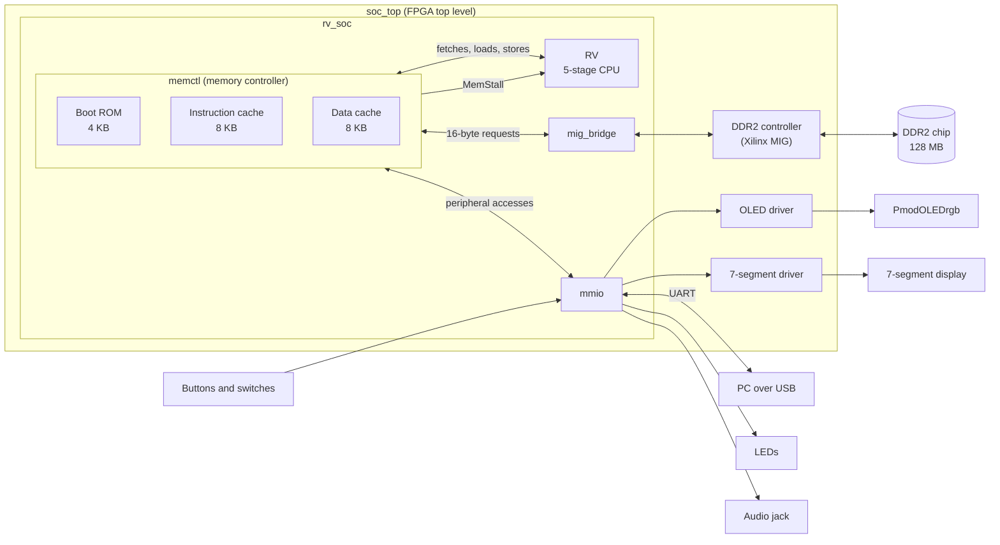
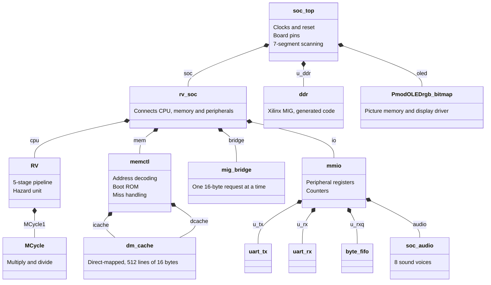
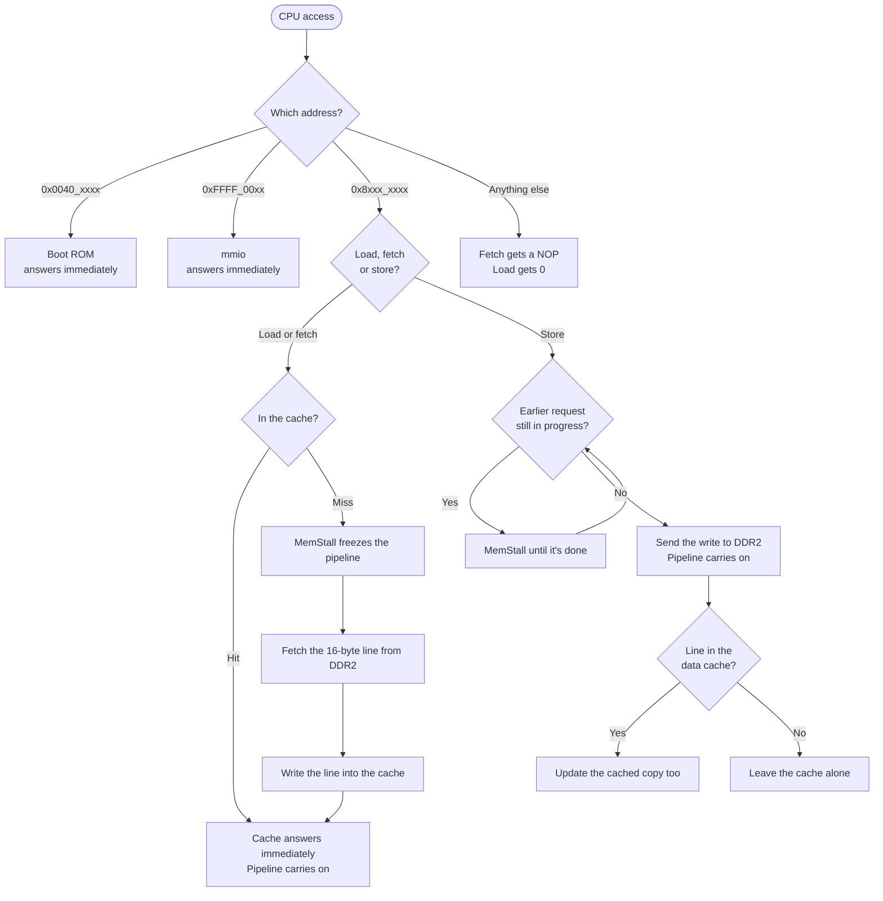
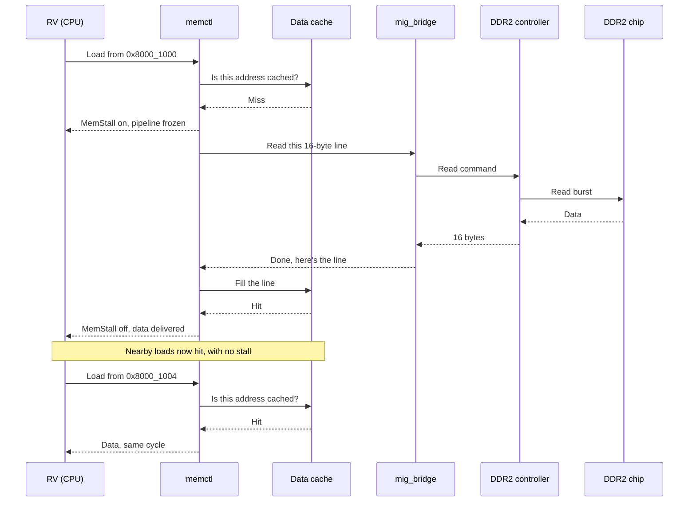
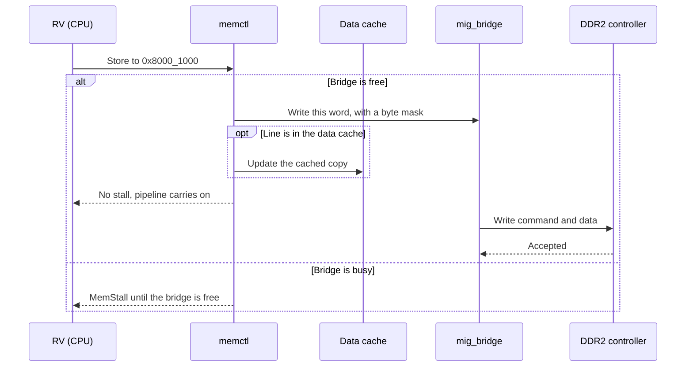
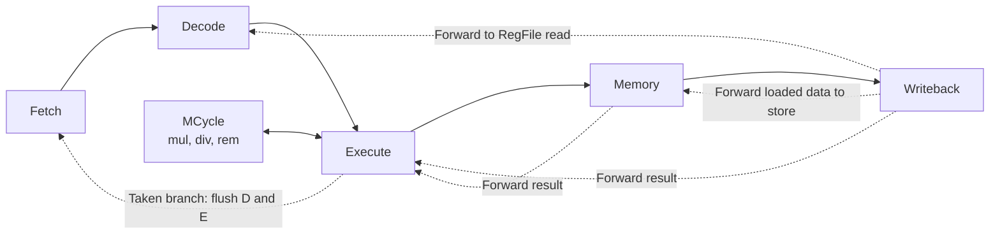
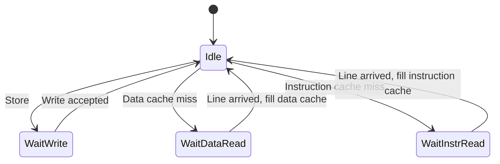
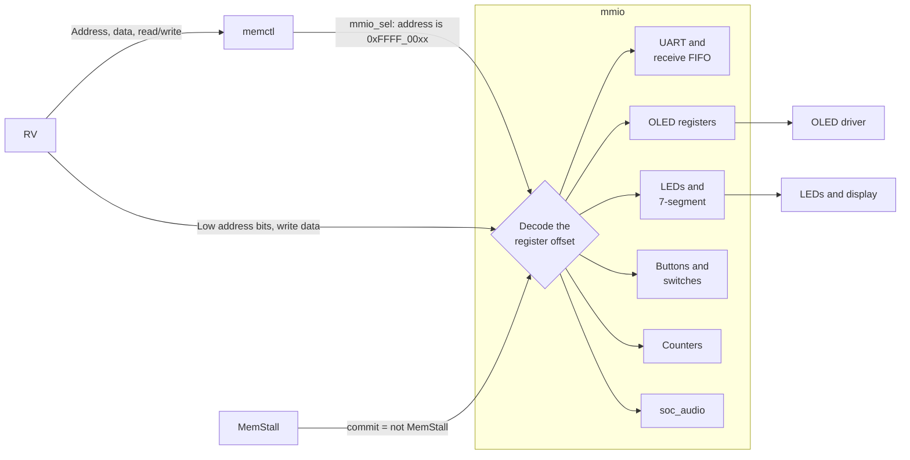
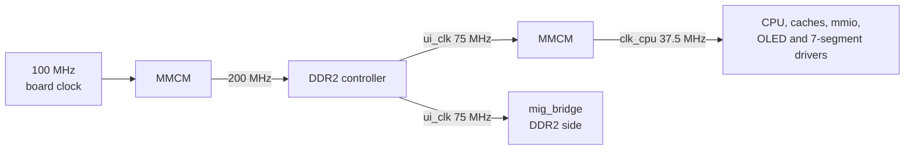
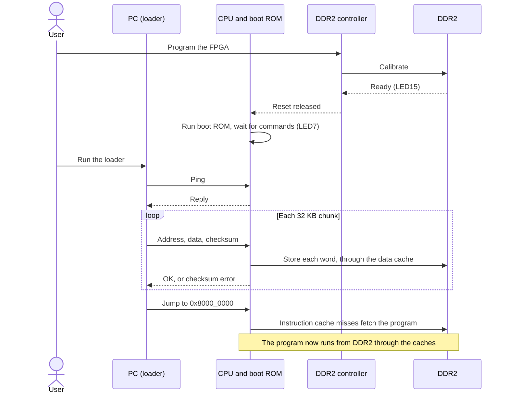

# RV32IM SoC for the Nexys A7

A system-on-chip built around our 5-stage pipelined RV32IM processor. It gives the processor 128 MB of DDR2 memory through instruction and data caches, along with an OLED display, USB serial, sound, buttons, switches and LEDs. It's powerful enough to run programs like DOOM.

This page explains how the parts work together. The DOOM game itself is on the `doom` branch.

- [System overview](#system-overview)
- [Module structure](#module-structure)
- [Memory map](#memory-map)
- [How a memory access flows](#how-a-memory-access-flows)
- [The processor](#the-processor)
- [The memory system](#the-memory-system)
- [Peripherals (MMIO)](#peripherals-mmio)
- [Clocks and reset](#clocks-and-reset)
- [From power-on to running a program](#from-power-on-to-running-a-program)
- [Where the files are](#where-the-files-are)
- [Generating the bitstream](#generating-the-bitstream)

## System overview

The CPU has two ways to reach the outside world, and both start at the **memory controller** (`memctl`). Fast accesses are answered immediately by the boot ROM or the caches. Slow accesses go out to DDR2 while the CPU is frozen. Peripheral accesses are passed to the **MMIO block**.

## Module structure

This UML class diagram shows which module contains which. Each arrow means "contains an instance of", and the label is the instance name in the code.

Each layer only deals with the one next to it:

| Layer | Knows about | Doesn't know about |
|---|---|---|
| `RV` | Instructions and the pipeline | Caches, DDR2 and peripherals. It just gets a `MemStall` signal |
| `memctl` | Addresses, hits and misses | DDR2 timing and what each peripheral does |
| `mig_bridge` | Moving a request to the DDR2 controller | Why the request was made |
| `mmio` | Peripheral registers | The rest of memory |
| `rv_soc` | How the blocks connect | The board, so it can also be simulated |
| `soc_top` | Clocks, pins and the DDR2 controller | How programs run |

## Memory map

| Address | Region | Size | Handled by |
|---|---|---|---|
| `0x0040_0000` | Boot ROM | 4 KB | `memctl`, answers immediately |
| `0x8000_0000` | DDR2, through the caches | 128 MB | `memctl`, `dm_cache`, `mig_bridge` |
| `0xFFFF_0000` | Peripherals | 256 bytes | `mmio`, answers immediately |

The CPU starts at `0x0040_0000`. Fetching from any other address returns a NOP, and reading from any other address returns 0.

## How a memory access flows

`memctl` looks at the address of every access and decides where it goes.

### A load that misses, then hits

### A store

Stores don't wait for DDR2 to finish. The CPU hands off the write and carries on, unless an earlier request is still in progress.

## The processor

`RV` is a classic 5-stage RV32IM pipeline, with full hazard handling so programs don't need NOPs.

| Situation | What happens |
|---|---|
| An instruction needs a result that's still in the pipeline | The result is forwarded from M or W into Execute, or from W into Decode |
| `lw` followed by an instruction using the loaded value | Stall one cycle, then forward. `lw` followed by `sw` of that value is forwarded with no stall |
| Taken branch or jump, decided in Execute | Flush the two wrong-path instructions in Decode and Execute |
| Multiply or divide (`MCycle`) | Hold Fetch, Decode and Execute until it's done, while older instructions finish |
| Cache miss or busy memory (`MemStall`) | Freeze the PC and every pipeline register. Overrides everything above |

Other features:
- It supports the full M extension, including `mulhsu`.
- Multiplication uses radix-4 Booth, and division is iterative. Both run in `MCycle`.
- `lb`, `lh`, `lbu`, `lhu`, `sb` and `sh` are handled in the Memory stage.

`MemStall` is the only thing the CPU needs for slow memory. When it's high, the whole pipeline holds still, so a cache miss just looks like a longer clock cycle to the program.

## The memory system

### Caches

Both caches are the same module, `dm_cache`, used twice.

| Property | Value |
|---|---|
| Size | 8 KB each, for instructions and data |
| Organisation | **Direct-mapped**: 512 lines of 16 bytes |
| Replacement | None needed. Each address fits only one slot, so a miss overwrites it |
| Storage | LUTRAM, which reads in the same cycle. So the pipeline didn't need redesigning |
| Writes (data cache) | **Write-through, no write-allocate**. Every store goes to DDR2, and a store hit also updates the cache |

The cache splits each DDR2 address into three parts:

A lookup is a hit if that line is valid and its stored tag matches.

### Request handling

`memctl` handles one DDR2 request at a time. If several are waiting, a store goes first, then a data miss, then an instruction miss.

### DDR2 connection

The DDR2 chip needs precise timing, calibration and constant refreshing. The Xilinx-generated **MIG** controller takes care of all of that, and gives the rest of the design a simple interface: read or write 16 bytes at an address.

`mig_bridge` connects `memctl` to that interface. `memctl` runs at 37.5 MHz and the MIG at 75 MHz, so the two exchange requests with a toggle handshake: `memctl` flips a request signal, and the bridge flips an acknowledge signal back when it's done.

## Peripherals (MMIO)

The CPU controls peripherals using ordinary loads and stores to `0xFFFF_00xx`.

### How it's set up

- `soc_top` instantiates `rv_soc`, and passes in the board's buttons, switches and UART pins.
- `rv_soc` instantiates `mmio` as `io`, setting the UART speed with the `UART_DIV` parameter.
- `mmio` instantiates its own helpers: `uart_tx`, `uart_rx`, a receive FIFO (`byte_fifo`) and `soc_audio`.
- The OLED and 7-segment drivers are in `soc_top`, and `mmio` sends them their data through `rv_soc`'s ports.

Register writes and read side effects only happen in the cycle where `commit` is high. If the pipeline freezes while a peripheral instruction is in the Memory stage, it can't send a character or draw a pixel twice.

### Registers

| Offset | Register | Access | Purpose |
|---|---|---|---|
| `0x00` | `UART_RX_VALID` | Read | A received byte is waiting |
| `0x04` | `UART_RX` | Read | Next received byte. Reading removes it |
| `0x08` | `UART_TX_READY` | Read | Ready to send |
| `0x0C` | `UART_TX` | Write | Send a byte |
| `0x20`, `0x24` | `OLED_COL`, `OLED_ROW` | Write | Pixel position |
| `0x28` | `OLED_DATA` | Write | Pixel colour |
| `0x2C` | `OLED_CTRL` | Write | Colour format and auto-advance mode |
| `0x60` | `LED` | Write | LED[7:0] |
| `0x64` | `DIP` | Read | Switches |
| `0x68` | `PB` | Read | Push buttons |
| `0x80` | `SEVENSEG` | Write | 8-digit display |
| `0xA0` | `CYCLECOUNT` | Read | Cycles since reset |
| `0xB0`, `0xB4` | Refill counters | Read | Instruction and data cache misses |
| `0xB8` | Stall counter | Read | Cycles spent in `MemStall` |
| `0xBC` | RX overflow | Read | The receive FIFO overflowed |
| `0xC0`–`0xDC` | Audio | Mostly write | 8 sound voices. `0xDC` reads which are playing |

The counters at `0xA0`–`0xB8` let a program measure its own cache performance.

## Clocks and reset

The CPU clock comes from the DDR2 controller's clock and is exactly half its speed. Because they're related, signals can cross between them without extra synchronisers.

The CPU stays in reset until DDR2 is calibrated and its clock is stable. The red **CPU_RESET** button resets the CPU and the OLED driver but not DDR2, so its contents survive.

| LED | Meaning |
|---|---|
| LED15 | DDR2 calibrated |
| LED14 | CPU clock locked |
| LED13 | CPU in reset |
| LED8 | Heartbeat |
| LED[7:0] | Set by software. The boot ROM uses LED7 for waiting, LED6 for loading and LED5 for a checksum error |

## From power-on to running a program

DDR2 is empty after programming, because the bitstream can't fill it. So the only code available at first is the boot ROM, which is built into the bitstream and can load a program over USB.

The loader and the boot ROM's source code are on the `doom` branch, in `doom_soc/host/load.py` and `doom_soc/sw/boot`. The `master` branch holds the compiled boot ROM, `boot.mem`.

## Where the files are

Hardware paths are under `project/project.srcs/sources_1`.

| Path | Contents |
|---|---|
| `imports/Asst_02`, `imports/Asst_03` | The processor (`RV.v`, `ALU.v`, `Decoder.v`, `MCycle.v` and others) and the OLED driver. Also the lab design's `Wrapper.v` and `TOP_Nexys.vhd` |
| `soc/soc_top.v`, `soc/soc_top.xdc` | FPGA top level and pin constraints |
| `soc/rv_soc.v` | Connects the CPU, memory system and peripherals |
| `soc/memory/` | `memctl.v`, `dm_cache.v`, `mig_bridge.v`, `boot.mem` |
| `soc/io/` | `mmio.v`, `uart.v`, `soc_audio.v` |
| `soc/ddr/` | Xilinx-generated DDR2 controller |

Elsewhere in the repository:

| Path | Contents |
|---|---|
| `soc_build/` | `build.tcl`, which creates the Vivado project and generates the bitstream |
| `project/project.srcs/sim_1/new/` | Testbenches and their test programs. `test_soc.v` tests the whole SoC against a DDR2 model |
| `legacy/` | Older assembly programs from earlier assignments |

The lab design (`TOP_Nexys.vhd` and `Wrapper.v`) is a separate, simpler system that uses the same processor with small built-in memories and `MemStall` tied to 0. It's what the local Vivado project in `project/` builds.

## Generating the bitstream

1. Open Vivado, without opening a project.
2. Choose **Tools > Run Tcl Script**, then select `soc_build/build.tcl`.
3. Wait for it to finish. This can take several minutes, and Vivado may look frozen while it runs.

The bitstream is saved as `soc_build/soc_top.bit`. The script also creates the project `soc_build/proj/rv_soc.xpr`, with all the source files and testbenches in it, so you can open that and work in the GUI as usual.

After pulling new changes, run the script again to pick up any new files. It replaces that project, but not your source files.

To simulate, open the project, right-click a testbench under **Simulation Sources**, and choose **Set as Top**. `test_soc` is the default. Then click **Run Simulation** and type `run all` in the Tcl Console. Each testbench prints `PASS` or `FAIL` at the end.

The design targets the Nexys A7-100T (also sold as the Nexys 4 DDR). Plug the PmodOLEDrgb into JB before programming the board.
